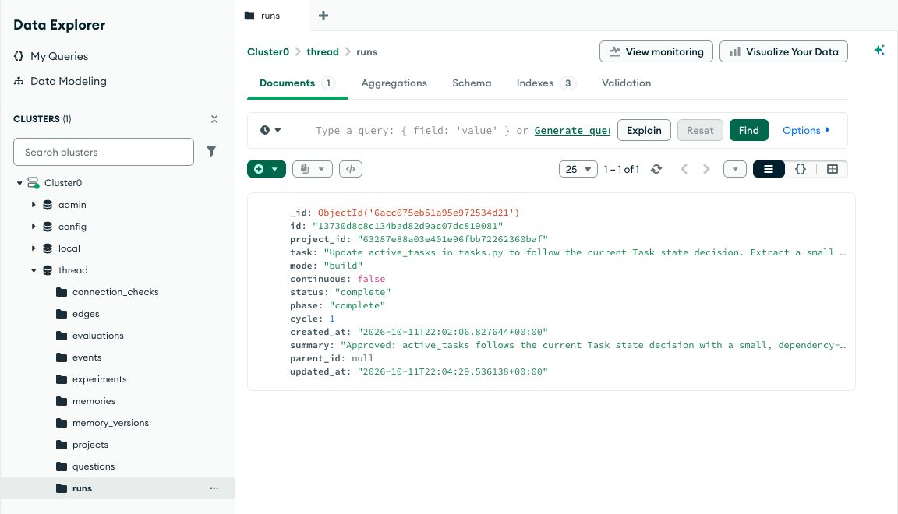

# Thread: reproducible learning proof

## The claim to demonstrate

“Your coding agent remembers what worked—and stops trusting it when your intent changes.”

Obsidian holds authored intent. Atlas stores versioned memories, dependencies, experiments and evidence. Codex acts on selected context. Passing checks and an independent review support a new procedure. Fresh sessions test whether that procedure helps on related work.

This is the narrowed hackathon story. A memory graph alone does not demonstrate recursive improvement. The final comparison must show an observable benefit, and an equal or worse result must be reported honestly.

## Current verified status

- A seeded historical procedure satisfies the original task-state contract.
- Changing the decision invalidates that procedure and excludes it from new context.
- The unchanged implementation fails 5 of 16 fixed checks under the new contract.
- All 24 automated tests pass in the receiving local session, including the three localhost integration tests. Tests use explicit agent doubles; they do not establish model performance.
- The Atlas-backed real Codex learning run completed, passed the external checks, received independent approval, and retained a validated procedure. Its manifest is `.thread/atlas-proof/manifest.json`. Fresh-session transfer evaluation is recorded separately and must be interpreted from its actual report.
- Atlas ping and a retained diagnostic insert/readback passed on October 11, 2026. The organizer Sandbox configuration remains private in `.env`; the credential-free report is `.thread/atlas-connection.json`.
- Obsidian 1.14.4 is installed and running. The plugin files and private settings are installed in the proof vault for its existing Atlas project. Application-control requests repeatedly timed out, so visual integration is still unverified.
- The completed real transfer comparison ran 18 fresh sessions. No memory, current notes, and notes plus learned skill each passed 6/6 tasks. This fixture does not establish incremental procedural benefit. The [measured report](evidence/transfer-report.md) includes time and token counts; [structured evidence](evidence/proof-results.json) retains each trial's score and integrity result.
- A separately started Atlas-backed coordinator retrieved the prior learning run and all 18 trials, excluded the stale procedure, selected the learned one, and completed a Brief with a linked vault note through the authenticated live HTTP API.



The [one-minute narrated evidence replay](evidence/thread-demo.mp4) summarizes these actual results, with [captions](evidence/thread-demo.vtt). It uses synthetic narration and evidence frames, including the real Atlas screenshot. It is explicitly labeled as an evidence replay and does not present an unverified Obsidian interaction as live footage.

## Prerequisites

Use a local terminal with Python 3.9+, Git, an authenticated Codex CLI, and Obsidian desktop. Run commands from this repository. The original development session denied localhost listeners and Codex app-server startup; the receiving session successfully ran both.

For prize eligibility, use the **organizer-provided Atlas Sandbox**, as required by the [participant guide](https://cerebralvalley.ai/e/mongodb-sftw-hackathon/details?backUrl=%2Fe%2Fmongodb-sftw-hackathon). SQLite is for development. A personal Atlas cluster does not establish compliance with that requirement.

```sh
python3 -m venv .venv
.venv/bin/python -m pip install -r requirements-atlas.txt
```

Configure `MONGODB_URI` through your local environment using the organizer connection string, and set `MONGODB_DATABASE` to a database allowed by your sandbox credentials. Do not put connection credentials in notes, recordings, or the public repository. `.env.example` documents variable names; `.env` files are not loaded automatically.

The proof's `--require-atlas` flag requires MongoDB configuration and a successful connection. It cannot independently verify that a URI belongs to the organizer; use the supplied credentials.

## Run the actual proof

Use a new root for each independent preparation. Keep the coordinator stopped while running standalone proof commands; they share a lock. Use the same Atlas configuration for every command and the later coordinator. For concurrent teams, use separate allowed databases.

### 1. Prepare historical state

```sh
.venv/bin/python -m companion.proof prepare --root .thread/atlas-proof --require-atlas
```

Creates an isolated Git repository, an Obsidian vault and a manifest. The historical truthiness procedure is **explicitly seeded demonstration data**, not an AI-generated discovery. Its original passing checks are stored as evidence.

### 2. Change the authored decision

```sh
.venv/bin/python -m companion.proof change-decision --root .thread/atlas-proof --require-atlas
```

The rule changes: the string `"false"` means active, even though Python considers it truthy. The source revision changes, the dependent procedure becomes stale, and the fixed acceptance grader reports the baseline failure.

```sh
.venv/bin/python -m companion.proof check --root .thread/atlas-proof --require-atlas
```

Inspect the source revision, stale skill, selected context and learning status. This command does not invoke a model.

### 3. Learn through real implementation and review

```sh
.venv/bin/python -m companion.proof learn --root .thread/atlas-proof --require-atlas
```

Codex plans and implements in isolated worktrees. The coordinator runs the external acceptance grader and regression checks. A fresh review must approve an improvement before promotion and procedural learning. If the source changes before promotion, the old context is rejected.

A completed model call is not sufficient: this command requires a completed run and a validated learned procedure. Failure is preserved and reported. It then prepares unimplemented summary/export functions for transfer trials.

Optionally pass `--model` with a model available to your account; use the same choice in the next command. Otherwise the CLI inherits your Codex configuration, which you should keep unchanged for the comparison.

### 4. Measure transfer in fresh sessions

```sh
.venv/bin/python -m companion.proof evaluate --root .thread/atlas-proof --require-atlas --repeats 3
```

This runs **18 real agent invocations**: two tasks × three context conditions × three repeats. Every trial begins at the same Git commit. Trial order is randomized with a recorded seed.

| Condition | Supplied knowledge |
|---|---|
| No memory | Common task and project goal; repository code remains visible |
| Current notes | Current authored requirements |
| Notes + learned skill | The same requirements plus the learned procedure |

The external grader covers empty input, booleans, numeric states, strings, missing fields, whitespace/case, mixed lists, ordering and CSV escaping. Its hash and verification-file integrity are checked. The agent is instructed not to inspect external benchmark assets; this is prompt-based isolation, not a security boundary.

The report records pass counts, elapsed time, token usage when available, model selection, base commit, grader hash and protocol. Raw trial patches and results remain in the store; the Markdown report is under `.thread/atlas-proof/runtime/evaluations/<id>/report.md`.

Compare **current notes** with **notes + learned skill** to assess incremental procedural benefit. A gain over no memory alone may just reflect access to requirements. All arms see previously improved repository code, so reusing that code is not evidence of memory benefit. This small custom benchmark cannot establish general capability; do not tune the grader after observing results.

## View evidence in Obsidian

After standalone commands finish:

```sh
.venv/bin/python scripts/install_plugin.py .thread/atlas-proof/fixture/vault
.venv/bin/python -m companion.server --state-dir .thread/atlas-proof/runtime
```

Open `.thread/atlas-proof/fixture/vault` as an Obsidian vault, enable Thread Companion under Community plugins, and copy the local token from `.thread/atlas-proof/runtime/token` into Thread settings. Open Thread and select the existing “Field Notes — learning proof” project. Do not reconnect it as a new project.

The panel shows authored intent, run evidence, stale procedures with source dependencies, and actual transfer counts. The “Codex installed” label only detects the executable; it does not certify successful model execution. “Atlas connected” verifies the selected backend, not organizer provenance.

For a live interaction, use Sync notes after editing a decision, Brief to inspect context, and Build to start a new task. Continuous Explore is separately opt-in. Stop the coordinator before rerunning standalone proof commands.

## Three-minute judging sequence

1. **0:00–0:25 — Problem:** “A coding agent can remember an old decision and confidently repeat the wrong behavior.” Show the task-state decision in Obsidian.
2. **0:25–0:55 — Invalidation:** Show the changed decision, excluded stale procedure and the five failing baseline checks. Explain that remembered procedures depend on source revisions.
3. **0:55–1:40 — Verified learning:** Show a real completed Codex experiment, its passing checks, the independent review and newly learned procedure. Use a recording if execution takes longer than the demo; label it as a recorded run.
4. **1:40–2:20 — Transfer:** Show the fresh-session comparison and actual report. State exactly what improved, or state that procedural lift was not demonstrated.
5. **2:20–2:45 — Why MongoDB:** Show the organizer Atlas database holding versioned source documents, dependency edges, experiment records and evaluation results. Obsidian remains the authored workspace.
6. **2:45–3:00 — Product:** “Leave your agent a goal, return to checked improvements, and keep the reasoning that still holds.”

For the one-minute submission video: 10 seconds problem, 15 invalidation, 20 verified improvement, 15 measured transfer and Atlas evidence. Do not present planned steps as finished capabilities.

## Build order from here

1. Configure the organizer Atlas credentials and run the proof in an environment where Codex can start.
2. Inspect actual learning and transfer results before choosing the judging claim.
3. Validate the Obsidian panel against that same persisted project.
4. Record the evidence, publish the requested public repository and prepare submission assets. Publication/submission have not been performed.

If the three arms tie, the defensible result is correct memory invalidation and verified execution; it is not proof of recursive skill improvement. Improve the learned review procedure or evaluate a separately specified task set before making a stronger claim. Retain negative results.
