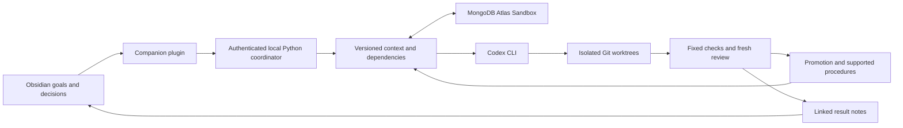

# Thread Companion

Your thinking in Obsidian becomes the memory and direction behind your coding agent.

Thread is a local Obsidian companion that compiles relevant goals and decisions into Codex context, supervises isolated experiments, checks the resulting code, and retains supported review procedures. When a source decision changes, dependent procedures become stale and are excluded from subsequent context.

## Workflow

- **Brief** selects applicable notes and procedures without launching a model.
- **Build** plans and implements a task, runs fixed checks, requests a fresh review, and promotes a verified candidate when the working branch is unchanged.
- **Review** checks the current repository against the user's goal and project checks.
- **Explore** investigates alternatives. Continuous refinement starts only when the user explicitly enables it and remains interruptible.

Correctness, goal adherence, and simplicity guide candidate selection. Stored evidence distinguishes a passing test, an independent review, successful reuse, and a measured transfer benefit.

## Architecture

Obsidian holds authored intent and readable results. Atlas stores structured memory, source revisions, relationships, experiment records, runs, and evaluations. Git preserves code alternatives. SQLite supports local development and tests; choosing Atlas never silently falls back to SQLite.

The coordinator binds to loopback and requires a private token. Agent permissions follow the supported Codex runtime. Experiments begin from a clean committed repository; concurrent user edits prevent automatic promotion.

## Learning proof

The reproducible fixture first seeds a historical truthiness procedure. A changed note makes the string `"false"` mean active, invalidates that procedure, and exposes five baseline failures. A real implementation and independent review can retain a new procedure. Separate fresh sessions then compare no memory, current notes, and notes plus the learned procedure.

The seeded historical procedure is demonstration data. A later successful task does not by itself prove that procedural memory caused improvement. See the [demo protocol](DEMO.md) and measured evidence before making a transfer claim.

## Current limits

Retrieval is lexical with typed priorities and graph expansion. Semantic ranking, exact-step recovery, automatic continuation after answers, optional automatic-review wiring, and live per-tool streaming remain incomplete. Candidate simplicity is estimated by changed line count. Research sources and model reviews are fallible; the external checks establish only the cases they measure.

Codex is the first adapter. Claude Code is planned. Obsidian visual validation and a submission recording remain separate completion requirements.
